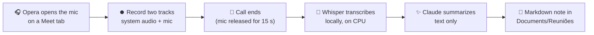

<div align="center">

# 🎙️ Meeting Notetaker

**Private, bot-free meeting notes for Google Meet, made on your own Windows PC.**

*It records the call quietly, transcribes it locally after the call ends, and leaves a clean Markdown summary in your Documents folder.*

<br>


<br>

[How it works](#-how-it-works) ·
[Install](#-install) ·
[Usage](#-usage) ·
[Configuration](#%EF%B8%8F-configuration) ·
[Privacy](#-privacy) ·
[Development](#-development)

</div>

<br>

## ✨ Highlights

|  |  |
|---|---|
| 🤫 **No bot in the call** | Nothing joins the meeting. It captures the audio your own computer already plays and hears. |
| 🪄 **Starts by itself** | It notices when Opera opens your microphone on a `Meet - …` tab and starts recording. |
| 🔒 **Audio stays on your PC** | Speech-to-text runs locally with [faster-whisper](https://github.com/SYSTRAN/faster-whisper). The WAV files are deleted once the transcript is saved. |
| 🧠 **Smart summaries** | The transcript text goes to the `claude` CLI and comes back as Summary · Decisions · Action items · Open questions, in Portuguese. |
| 🙈 **Screen-share friendly** | One small popup that you can dismiss and that never comes back during the same meeting. The "ready" notice goes quietly to the Action Center. |
| 🛟 **Hard to lose a meeting** | Recordings survive crashes, laptop sleep and offline moments. Pending summaries are retried automatically. |

<br>

## 🧭 How it works



- 🔊 **Two tracks, two voices.** The system audio becomes **Outros** (everyone else) and your microphone becomes **Eu** (you). The lines are interleaved by time.
- 🎚️ **Echo removal.** On laptop speakers your mic also picks up the other people. Lines that just repeat what *Outros* said at the same moment are dropped.
- 💤 **Silence filtering.** Segments that Whisper "hears" in silence or noise are discarded.

<br>

## 📄 What you get

One file per meeting, for example `2026-11-13 14h05 - Alinhamento.md`:

```markdown
# Alinhamento

_13/11/2026 14:05_

## Resumo
Short 5–10 line overview of the meeting…

## Decisões
- The report will be delivered on Friday.

## Pendências
- Review the report — Maria — Friday

## Pontos em aberto
Nenhum.

## Transcrição

[00:00:02] Outros: Bom dia a todos…
[00:00:09] Eu: Combinado, eu envio sexta.
```

<br>

## 📦 Install

### Requirements

- 🪟 Windows 10/11
- 🌐 [Opera](https://www.opera.com/) for Google Meet (other browsers: see [Configuration](#%EF%B8%8F-configuration))
- ⚡ [uv](https://docs.astral.sh/uv/), or Python 3.12 available through `py -3.12`
- 🤖 [Claude Code](https://claude.com/claude-code) CLI installed and logged in (`claude` on your PATH or in `~/.local/bin`)
- 💾 About 1 GB free for the Python environment and the Whisper `small` model

### One command

```powershell
git clone https://github.com/anita211/anotador-reunioes.git
cd anotador-reunioes
powershell -ExecutionPolicy Bypass -File .\install.ps1
```

The installer:

1. 🐍 creates a `.venv` with Python 3.12 and installs the dependencies;
2. ⚙️ copies `config.example.json` to `%LOCALAPPDATA%\AnotadorReunioes\config.json`;
3. 🚀 adds a shortcut to the Windows **Startup** folder, so the app launches at login without a console window;
4. ▶️ starts the app right away.

> [!NOTE]
> The first transcription downloads the Whisper model (about 460 MB for `small`), so that first run takes longer.

<br>

## 🖱️ Usage

A small grey note icon lives in the system tray, next to the clock.

| Action | What happens |
|---|---|
| **Join a Meet call in Opera** | Recording starts within a few seconds and a **● Gravando reunião** popup appears. |
| **Click OK** (or wait 15 s) | The popup closes and doesn't return during that meeting. |
| **Click "Cancelar gravação"** | The audio is discarded, and that meeting won't be recorded again for the next 3 hours. |
| **Leave the call** | About 15 s later the recording stops. Transcription and the summary run in the background. |
| **Left-click the tray icon** | Starts or stops a **manual** recording, for any audio source. |
| **Right-click the tray icon** | Opens the menu: start/stop recording · open the meetings folder · quit. |

> [!TIP]
> Connect your Bluetooth headset **before** joining a call. If the default audio device changes mid-call while the old device is still present, the rest of the call can be recorded from the old device.

<br>

## ⚙️ Configuration

Edit `%LOCALAPPDATA%\AnotadorReunioes\config.json` and restart the app. You can leave out any key you don't want to change.

| Key | Default | Description |
|---|---|---|
| `browser_exe` | `"opera.exe"` | Browser process to watch, e.g. `"chrome.exe"` or `"msedge.exe"` |
| `title_keyword` | `"Meet"` | Window-title prefix that marks a call tab (`Meet - abc-defg-hij`) |
| `poll_seconds` | `3.0` | How often the mic and window titles are checked |
| `title_wait_seconds` | `30.0` | How long after the mic opens to wait for a Meet title |
| `stop_grace_seconds` | `15.0` | How long the mic must stay released before the recording stops |
| `warning_seconds` | `15.0` | How long the recording popup stays on screen |
| `whisper_model` | `"small"` | `"medium"` is more accurate but slower |
| `output_dir` | `Documents\Reuniões` | Where the notes are saved |
| `claude_cmd` | `"claude"` | Claude CLI executable |
| `claude_timeout_seconds` | `600.0` | Maximum time allowed for one summary |

Logs are written to `%LOCALAPPDATA%\AnotadorReunioes\anotador.log`.

<br>

## 🔐 Privacy

- 🎧 **Audio never leaves your computer.** It is recorded to `%LOCALAPPDATA%\AnotadorReunioes\rec` and deleted right after the transcript is written.
- 📝 **Only the transcript text** is sent to Claude, through the CLI, which runs with:
  - `--no-session-persistence`, so no copy of the transcript is kept in `~/.claude`;
  - `--tools ""`, `--strict-mcp-config` and `--disable-slash-commands`, so the CLI only works with text and can't act on anything a participant says;
  - a working directory outside any project, so no `CLAUDE.md` files are loaded.
- ☁️ If your Documents folder is synced by OneDrive, your notes are synced too. Point `output_dir` elsewhere to avoid that.
- 🌐 When the Whisper model loads, `huggingface_hub` checks for a newer model version. It sends no audio or text.

> [!IMPORTANT]
> Recording conversations can be regulated where you live and by your employer's or clients' policies. Make sure your use is allowed before relying on this tool.

<br>

## 🛡️ Reliability

| Situation | Behaviour |
|---|---|
| You drop and rejoin within 15 s | It stays one continuous recording. |
| You rejoin the same meeting within 10 min | Recording resumes **without** a popup, in a new file. |
| The laptop sleeps mid-call | The recording is closed and processed. If you're still in the call after waking, it resumes quietly. |
| The audio device is unplugged | The current part is saved and recording reopens on the new default device. |
| No internet or Claude fails | The transcript is saved as `_Resumo pendente_` and the summary is retried at next start. |
| The app crashes or you quit while recording | The WAVs are picked up and processed at next start. |
| A very long call | Recording is capped at 4 h per file, and transcription runs in 10-minute windows to keep memory low. |

<br>

## 🗂️ Project structure

```
anotador-reunioes/
├── anotador/
│   ├── app.py           # tray icon, polling loop, controller, worker thread
│   ├── detector.py      # meeting state machine + Windows audio-session probes
│   ├── recorder.py      # WASAPI loopback + mic → two aligned WAV files
│   ├── transcriber.py   # faster-whisper, echo removal, Eu/Outros merge
│   ├── summarizer.py    # isolated `claude -p` call
│   ├── pipeline.py      # transcribe → save → delete audio → summarize
│   ├── output.py        # Markdown note and safe filenames
│   ├── ui.py            # recording popup + silent notification
│   └── config.py        # settings with safe defaults
├── tests/               # pytest suite
├── install.ps1          # one-shot installer
├── config.example.json
└── design.md            # original design notes (Portuguese)
```

<br>

## 🧪 Development

```powershell
.venv\Scripts\python.exe -m pytest -q
```

The core logic (detection state machine, track merging, filenames, pipeline, controller) is pure Python and fully unit-tested. Windows-specific adapters (Core Audio, WASAPI, Tk, toasts) are thin wrappers around it.

To run the app from a terminal and see its output:

```powershell
.venv\Scripts\python.exe -m anotador
```

<br>

## 🩺 Troubleshooting

<details>
<summary><b>The popup didn't appear when I joined a call</b></summary>

- Check that the app is running: the grey icon should be next to the clock.
- Make sure the call is in **Opera** (or whatever `browser_exe` is set to) and that the tab title starts with `Meet - `.
- Look at `%LOCALAPPDATA%\AnotadorReunioes\anotador.log`.
- As a fallback, left-click the tray icon to record manually.

</details>

<details>
<summary><b>The transcript only has "Eu" or only "Outros"</b></summary>

One of the tracks was silent. For example, nobody else spoke, or the audio went to a device that isn't the Windows default output.

</details>

<details>
<summary><b>The note says "Resumo pendente"</b></summary>

Claude wasn't reachable. Check that `claude -p "oi"` works in a terminal, then restart the app to retry.

</details>

<details>
<summary><b>How do I uninstall?</b></summary>

1. Quit the app from the tray menu.
2. Delete `Anotador de Reunioes.lnk` from `shell:startup`.
3. Delete `%LOCALAPPDATA%\AnotadorReunioes` and this folder.

</details>

<br>

<div align="center">

Made with ☕ and a lot of meetings.

</div>
